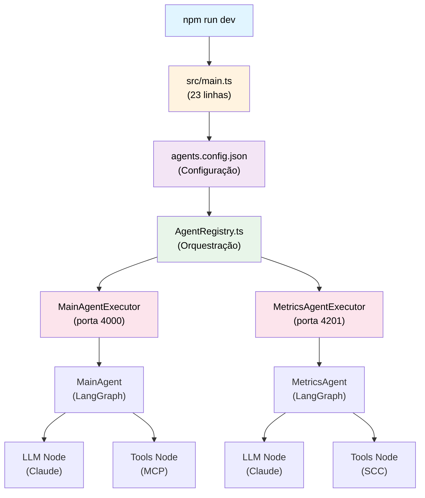
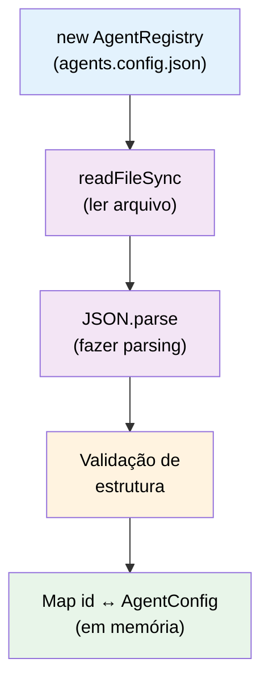
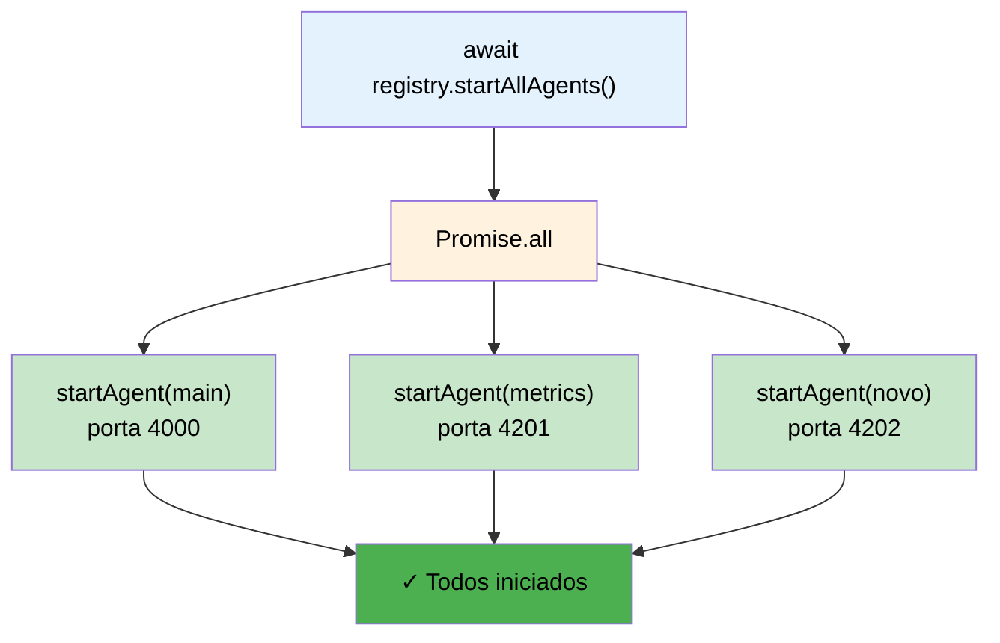
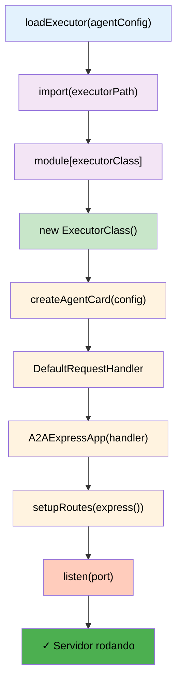
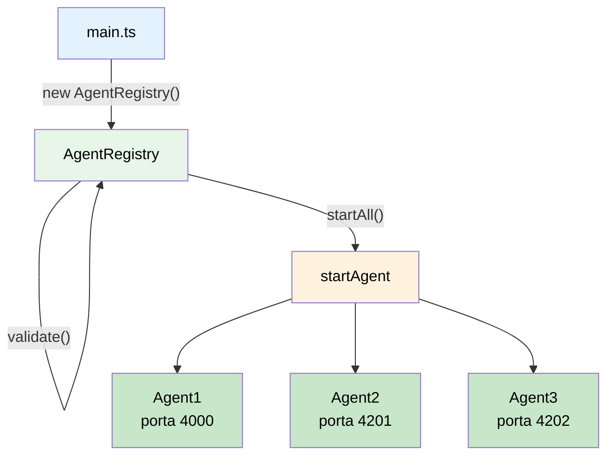
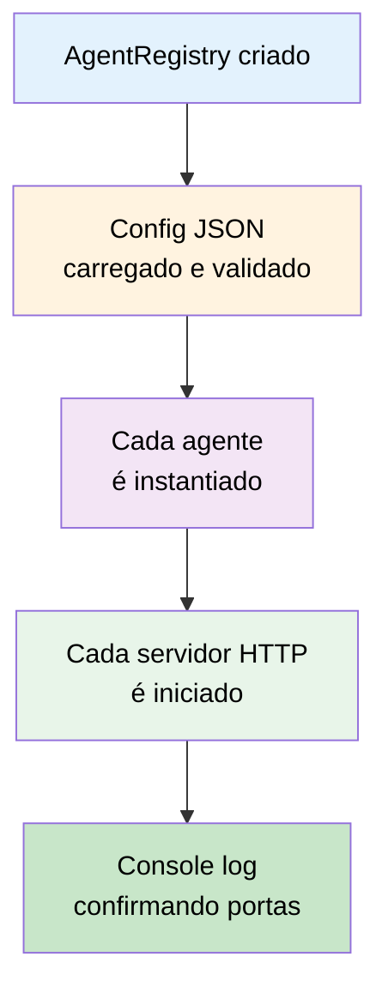
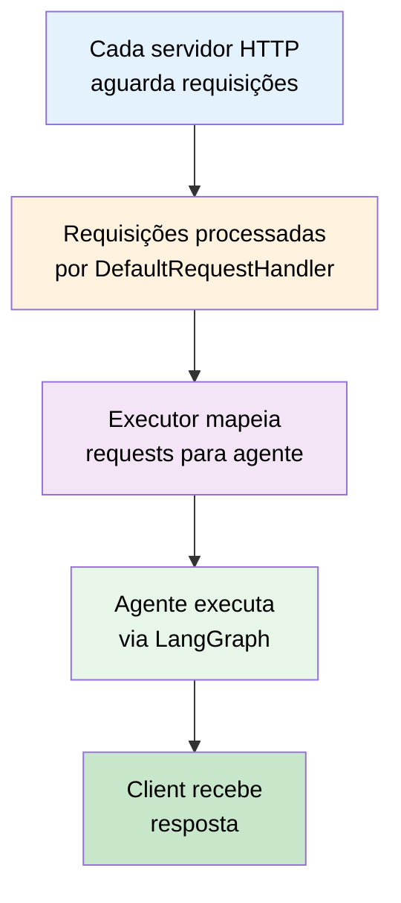
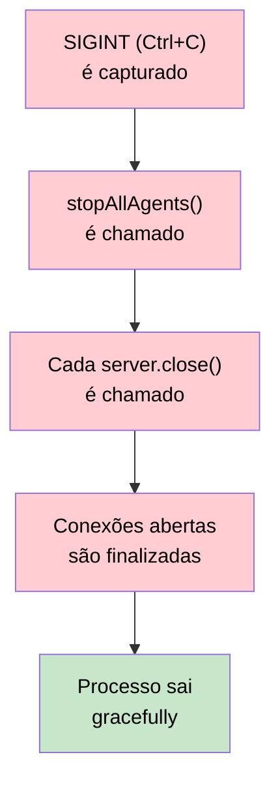
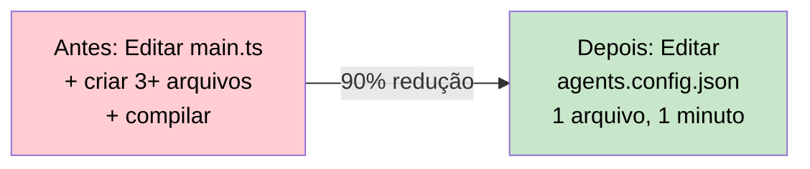
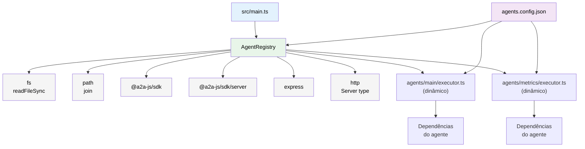

# 🏗️ Arquitetura do Sistema de Registro de Agentes

## Visão Geral

O novo sistema implementa um padrão de **Factory com Configuração Externa**, permitindo escalabilidade sem modificar código.



---

## Fluxo de Inicialização Detalhado

### 1. Carregamento de Configuração


### 2. Inicialização de Agentes (Paralela)


### 3. Para Cada Agente


---

## Estrutura de Dados

### agents.config.json
```json
{
  "agents": [
    {
      "id": "identificador-unico",
      "name": "Nome Exibível",
      "description": "Descrição funcional",
      "port": 4000,
      "executorPath": "./src/agents/main/executor.ts",
      "executorClass": "MainAgentExecutor",
      "skill": {
        "id": "skill_id",
        "name": "Skill Name",
        "description": "Skill description",
        "tags": ["tag1", "tag2"],
        "examples": ["Exemplo 1", "Exemplo 2"]
      }
    }
  ]
}
```

### Mapa Interno do AgentRegistry
```typescript
config: AgentsConfig {
  agents: AgentConfig[] (do JSON)
}

servers: Map<string, Server> {
  "main" → Server (http.Server),
  "metrics" → Server (http.Server)
}
```

---

## Padrões de Design Utilizados

### 1. **Factory Pattern**
```typescript
// loadExecutor(): Cria instância dinamicamente
const module = await import(agentConfig.executorPath);
const ExecutorClass = module[agentConfig.executorClass];
return new ExecutorClass();
```

### 2. **Registry Pattern**
```typescript
// AgentRegistry: Mantém registro de agentes
private servers: Map<string, Server> = new Map();
// Permite access, start, stop de qualquer agente
```

### 3. **Configuration-Driven Design**
```typescript
// Comportamento definido por JSON, não por código
// Facilita extensibilidade sem mudança de código
```

### 4. **Async Factory**
```typescript
// Promise-based loading para suportar dynamic imports
private async loadExecutor(agentConfig): Promise<AgentExecutor>
```

---

## Sequência UML Simplificada



---

## Validação de Configuração

O `AgentRegistry` valida:

1. **Estrutura**: Arquivo JSON válido e com array 'agents'
2. **Campos Obrigatórios**: Todos os campos necessários presentes
3. **Tipos**: Campos têm tipo correto (port é number, etc)
4. **Unicidade**: IDs e portas não se repetem
5. **Intervalo de Porta**: Portas entre 1024-65535
6. **Existência de Classe**: ExecutorClass existe no módulo importado

---

## Ciclo de Vida

### Inicialização (Startup)


### Execução (Runtime)


### Encerramento (Shutdown)


---

## Escalabilidade

### Adicionar um Novo Agente



### Performance
- **Inicialização**: O(n) onde n = número de agentes (paralelo)
- **Validação**: O(n) onde n = número de agentes
- **Busca de Agente**: O(1) com Map
- **Runtime**: Sem overhead, direto para o agente

---

## Diagrama de Dependências



---

## Comparação: Antes vs Depois

| Aspecto | Antes | Depois |
|---------|-------|--------|
| **Localização da config** | Espalhado em main.ts | Centralizado em JSON |
| **Adicionar agente** | Editar código + compilar | Editar JSON |
| **Escalabilidade** | Linear com código | Logarítmica |
| **Modificação de portas** | Código | JSON |
| **Número de linhas de main.ts** | ~90 | 23 |
| **Risco de erro ao adicionar** | Alto | Baixo (JSON é validado) |
| **Facilidade de entender fluxo** | Média | Alta (grafo visual) |

---

## Extensões Futuras Possíveis

### 1. Suporte a Variáveis de Ambiente
```json
{
  "port": "${AGENT_PORT:-4000}"
}
```

### 2. Suporte a Grupos de Agentes
```json
{
  "groups": {
    "production": ["main", "metrics"],
    "staging": ["main"]
  },
  "startGroup": "production"
}
```

### 3. Suporte a Health Checks
```json
{
  "healthCheck": {
    "enabled": true,
    "interval": 30000
  }
}
```

### 4. Suporte a Dependências Entre Agentes
```json
{
  "dependencies": ["main-agent"],
  "startAfter": ["metrics-agent"]
}
```

---

**Arquitetura clara, extensível e fácil de manter! 🚀**
