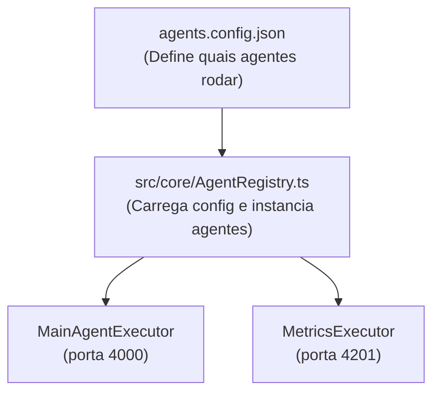

# 🏗️ Sistema de Registro Dinâmico de Agentes

## Resumo da Solução

Você agora tem um sistema **modular e escalável** para gerenciar múltiplos agentes sem modificar o código principal. A execução de agentes é controlada por um **arquivo de configuração JSON**.

### Arquivos Modificados

| Arquivo | Mudança | Por quê? |
|---------|---------|---------|
| [src/main.ts](../src/main.ts) | ✅ **Refatorado** | Agora usa `AgentRegistry` para carregar agentes dinamicamente |
| `agents.config.json` | 🆕 **Criado** | Configuração centralizada de todos os agentes |
| [src/core/AgentRegistry.ts](../src/core/AgentRegistry.ts) | 🆕 **Criado** | Factory inteligente que instancia agentes a partir da config |

### Arquivos NÃO Modificados

- ✅ `src/agents/main/executor.ts`
- ✅ `src/agents/metrics/executor.ts`
- ✅ Todos os outros arquivos de agentes

---

## 🔄 Como Funciona



---

## 📝 Exemplo: agents.config.json

```json
{
  "agents": [
    {
      "id": "main",
      "name": "Software Reverse Engineering Agent",
      "description": "...",
      "port": 4000,
      "executorPath": "./src/agents/main/executor.ts",
      "executorClass": "MainAgentExecutor",
      "skill": { /* ... */ }
    },
    {
      "id": "metrics",
      "name": "Metrics Primary Extractor Component",
      "description": "...",
      "port": 4201,
      "executorPath": "./src/agents/metrics/executor.ts",
      "executorClass": "MetricsAgentExecutor",
      "skill": { /* ... */ }
    }
  ]
}
```

---

## 🚀 Como Usar

### Iniciar Todos os Agentes

```bash
npm run dev
```

**Saída esperada:**
```
🚀 Agent 'main' started on http://localhost:4000
🚀 Agent 'metrics' started on http://localhost:4201
```

### Ativar/Desativar Agentes

Basta editar o `agents.config.json` e comentar/descomentar agentes:

```json
{
  "agents": [
    // Agente ativo ✅
    { "id": "main", ... },
    
    // Agente desativado ❌
    // { "id": "metrics", ... }
  ]
}
```

---

## ➕ Adicionando um Novo Agente

### Passo 1: Criar a estrutura
```
src/agents/novo-agente/
├── agent.ts
├── executor.ts
└── nodes/
    ├── LLMCallerNode.ts
    ├── ToolsNode.ts
    └── AgentsCallerNode.ts
```

### Passo 2: Implementar o executor
```typescript
// src/agents/novo-agente/executor.ts
export class NovoAgentExecutor implements AgentExecutor {
  async execute(requestContext, eventBus) {
    // sua lógica aqui
  }
  // ...
}
```

### Passo 3: Registrar em agents.config.json
```json
{
  "agents": [
    // agentes existentes...
    {
      "id": "novo-agente",
      "name": "Novo Agente",
      "description": "Descrição...",
      "port": 4202,
      "executorPath": "./src/agents/novo-agente/executor.ts",
      "executorClass": "NovoAgentExecutor",
      "skill": { /* ... */ }
    }
  ]
}
```

**Pronto!** 🎉 Nenhuma outra modificação necessária.

---

## 🔌 API do AgentRegistry (Avançado)

```typescript
import { AgentRegistry } from "@core/AgentRegistry.js";

const registry = new AgentRegistry("agents.config.json");

// Iniciar todos os agentes
await registry.startAllAgents();

// Obter config de um agente específico
const config = registry.getAgentConfig("main");

// Parar agente específico
await registry.stopAgent("metrics");

// Parar todos os agentes
await registry.stopAllAgents();
```

---

## 📚 Documentação Completa

Veja [docs/ADDING_NEW_AGENTS.md](../docs/ADDING_NEW_AGENTS.md) para um guia detalhado.

---

## ✨ Benefícios

| Benefício | Antes | Depois |
|-----------|-------|--------|
| **Adicionar novo agente** | Editar `main.ts` + criar código | Apenas editar JSON |
| **Modificar portas/nomes** | Alterar TypeScript | Alterar JSON |
| **Escalabilidade** | Código cresce | Config cresce |
| **Manutenibilidade** | Difícil | Fácil |
| **Reutilização** | Manual | Automática |

---

## 🎯 Resumo

- ✅ Sistema modular e extensível
- ✅ Configuração centralizada em JSON
- ✅ Sem mudanças em arquivos de agentes
- ✅ Suporta múltiplos agentes em paralelo
- ✅ Graceful shutdown integrado
- ✅ Fácil de adicionar novos agentes
